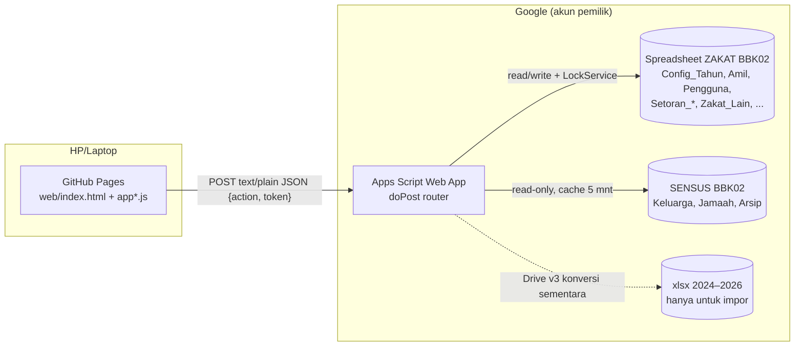

# Design — Zakat BBK02 MVP

> **Status:** DISETUJUI. Model data rinci ada di `.kiro/steering/data-model.md`, dan aturan di `domain-zakat.md`. Dokumen ini fokus pada arsitektur, API, dan alur.

## Arsitektur

## API (semua lewat `POST`, lihat `routes_()` di `Api.gs`)
| Action | Peran | Ringkas |
|---|---|---|
| `ping` | publik | cek hidup |
| `login` | publik | `{pin, device}` → `{token, role, nama, idAmil}` |
| `logout` | login | hapus token |
| `bootstrap` | semua | config tahun aktif/terpilih, daftar tahun, amil, `batasLewat` |
| `kkList` | admin, amil | daftar KK + anggota + status per jiwa + simpatisan terkait + statistik amil |
| `cariMuzakki` | admin, amil | cari jamaah sensus & simpatisan |
| `simpanFitrah` / `getFitrah` / `hapusFitrah` | admin, amil / admin, amil / admin | setoran fitrah (+fidyah opsional) |
| `simpanLain` / `hapusLain` | admin, amil / admin | mal, tijaroh, campuran, fidyah (auto susulan) |
| `daftarSimpatisan` / `simpanSimpatisan` | admin, amil | master simpatisan |
| `dashboard` | semua | `ringkasTahun_(tahun, detail=true)` |
| `tren` | semua | ringkasan semua tahun |
| `daftarSetoran` | semua | transaksi per tahun |
| `getConfig` / `simpanConfig` / `tahunBaru` | admin | konfigurasi tahun |
| `simpanAmil` | admin | amil + saham + PIN |
| `daftarPengguna` / `simpanPengguna` | admin | akun Admin/Pengurus |
| `simpanSerahUB` / `hapusSerahUB` | admin, amil / admin | serah UB |
| `simpanBeli` / `hapusBeli` | admin | pembelian beras |
| `simpanBagianAmil` | admin | angka final musyawarah per lampiran |

## Alur utama
### Setoran fitrah (amil di HP)
1. Login PIN → `bootstrap` + `kkList`, lalu beranda amil (pengingat batas, filter status).
2. Pilih KK → form: centang anggota, SM terkait, dan JM luar → pilih jenis → isi uang/kg → (fidyah) → Simpan.
3. Backend:
   - cek tahun BUKA dan batas;
   - cek tanggal ≤ batas;
   - cek amil;
   - cek duplikat jiwa (dalam lock);
   - hitung wajib, selisih, status, dan tujuan;
   - tulis Setoran_Fitrah + Setoran_Fitrah_Jiwa (+ Zakat_Lain fidyah);
   - catat Log.
4. Kembali ke beranda, dengan cache KK di-refresh.

### Dashboard
`ringkasTahun_` membaca setoran, zakat lain, serah UB, pembelian, bagian amil, dan sensus (hanya tahun berjalan). Fungsi ini menghitung agregat, pembagian (`splitLargestRemainder_`), per amil, harian, UB, beras, belum setor, dan 15 terbaru.

### Impor
`imporTahun_` menjalankan langkah berikut:
1. Konversi xlsx menjadi Sheets sementara.
2. Parse muzakki, mal, susulan, dan bagian amil (`ImportParse.gs`).
3. Hapus data IMPOR lama tahun itu.
4. Tulis amil, setoran, mal, fidyah, dan bagian amil.
5. Tulis review, lalu cek total ke Impor_Log.
6. Buang file sementara ke trash.

## Keputusan desain penting
Daftar lengkapnya ada di `docs/decisions.md`. Ringkasnya:
- Satu spreadsheet untuk semua tahun (kolom Tahun), bukan file atau sheet per tahun.
- Rincian per jiwa (Setoran_Fitrah_Jiwa) untuk data aplikasi. Data impor hanya berupa jumlah.
- Router sebagai fungsi `routes_()`, supaya tidak bergantung urutan file.
- Pembulatan memakai sisa terbesar. Bagian amil final diisi manual (musyawarah).
- PIN pribadi sebagai identitas, sehingga PIN wajib unik.

## UI
Mockup yang disetujui ada di `docs/mockup.md`. Komponen dan token ada di `ui-design-system.md`.

| Layar | Route | File |
|---|---|---|
| Login PIN | `#/login` | app.js |
| Beranda amil | `#/amil` | app.js |
| Form fitrah | `#/fitrah/<kk>` | app2.js |
| Form mal/fidyah | `#/lain` | app2.js |
| Pemantauan | `#/dash` | app3.js |
| Tren | `#/tren` | app3.js |
| Data Setoran | `#/setoran` | app3.js |
| Konfigurasi | `#/config` | app3.js |

## Penanganan error
- **Error backend:** semua error dilempar dengan pesan Indonesia, lalu diubah menjadi `{ok:false,error}` dan tampil sebagai toast merah.
- **Sesi habis:** `SESI_HABIS` → frontend logout lokal → kembali ke login.
- **Konkurensi:** LockService 20 detik. Bila lock gagal, Apps Script melempar error dan pengguna diminta mencoba lagi.
